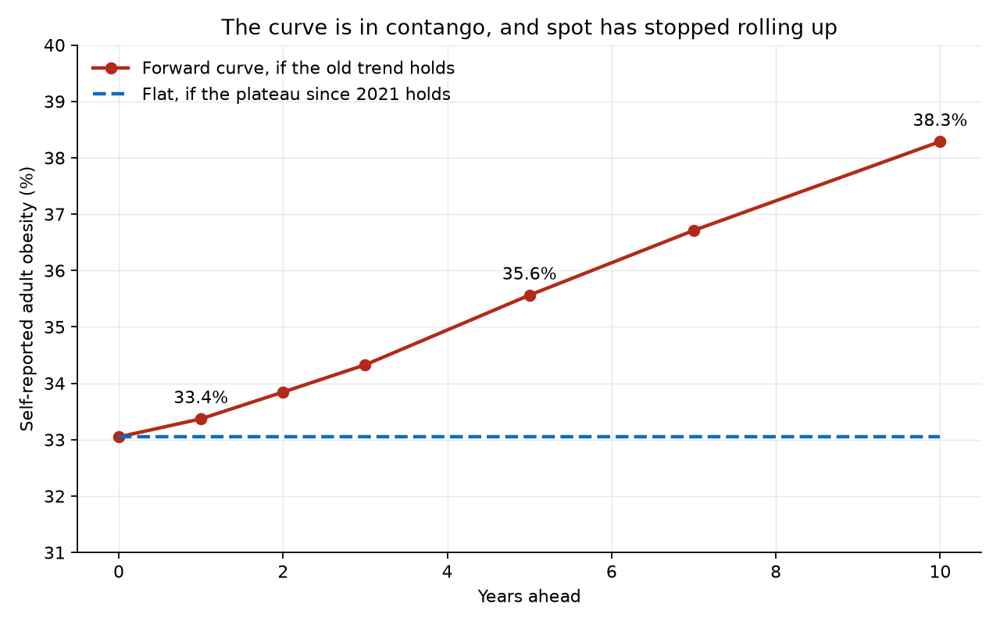
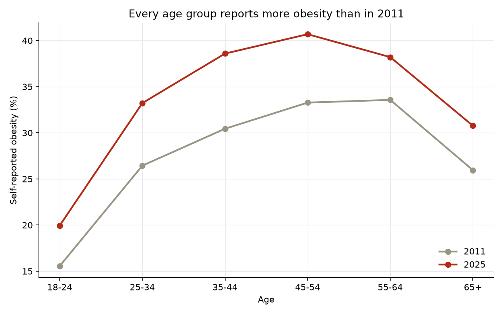
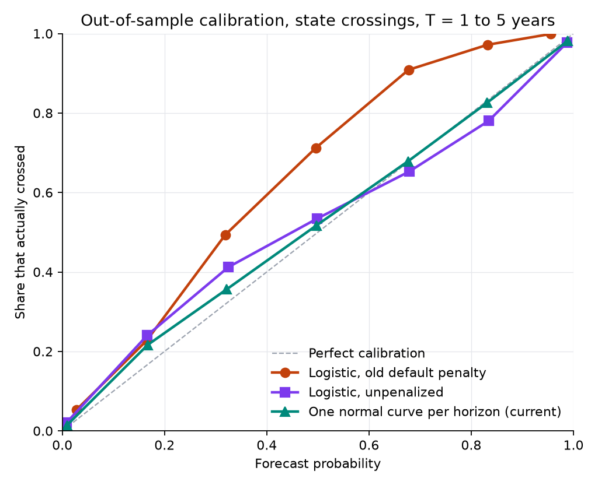
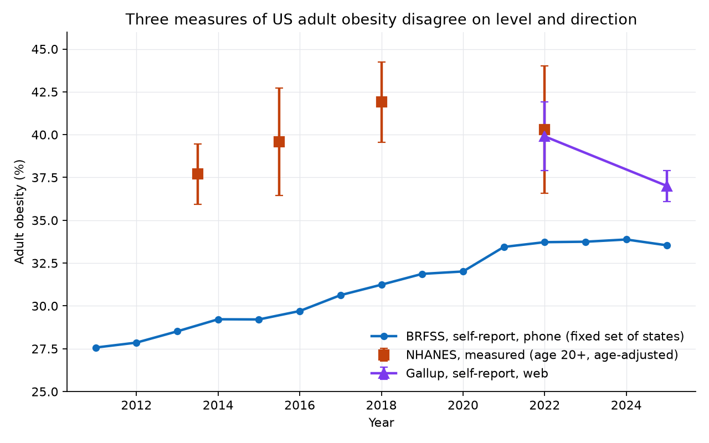

# US Obesity Threshold Surface

I care a lot about health, and I'm worried about how Americans eat and what it's doing to them. I also think in options. So I took CDC's state obesity data and built the surface a desk would build: the chance of crossing each obesity level at each horizon. Then I backtested it and asked what it says about the country.

**What I found:**

- **The rise has paused at a high level. It hasn't reversed.** Self-reported obesity has been flat since 2021, at about 33%, and 68% of adults report being overweight or obese. CDC's measured survey puts obesity at 40%.
- **The plateau doesn't look like better eating.** Since 2017, the share of adults who don't eat fruit daily rose from 37% to 43%, and for vegetables from 18% to 22%.
- **The whole outlook is a bet on drift.** If the old trend returns, 41 states are over 35% within 10 years. If the plateau holds, it stays near 21. Nothing else in the model comes close to mattering that much.
- **A flat national rate needs generations to gain far less.** It would take about a quarter of the gain each generation saw from 2015 to 2025.
- **Each point is worth a lot.** One point of obesity is about 2.7 million adults and roughly $5 billion a year in excess medical costs.
- **I can't show that food causes this.** Every state-level food test I ran came up short once national trends were removed. That's the limit of this data, and my concern about food remains a hypothesis.

The analogy organizes the results. Nothing here trades, and these are historical frequencies on mostly self-reported data, not prices.

## Run it

```bash
pip install -r requirements.txt
python scripts/01_download_cdc_obesity.py   # optional, the raw data is already in data/raw
python scripts/build_all.py                 # surface
python scripts/03_obesity_trends.py         # trend plots
python scripts/04_exposure_data.py          # exposure index
python scripts/05_exposure_regression.py    # national analysis
python scripts/06_panel_regression.py       # state panel
python scripts/07_robustness.py             # stress tests on the national result
python scripts/08_backtest.py               # out-of-sample test of the surface
python scripts/09_download_food_environment.py  # optional, the Census data is already in data/raw
python scripts/10_state_food_panel.py       # restaurant density by state
python scripts/11_download_latest_brfss.py  # optional, the latest CDC data is already in data/raw
python scripts/12_holdout_2025.py           # score frozen models on 2025
python scripts/13_measured_gap.py           # self-report vs measured obesity
python scripts/14_trend_break.py            # trend break and age pattern
python scripts/15_download_health_context.py  # optional, diet, activity and adult population are already in data/raw
python scripts/16_options_lens.py           # the options reading and health results
```

## Reading it like an options desk

| Options idea | What the data shows | What it means for health |
|---|---|---|
| **Spot** | 33.0% for 2025. CDC reports 33.5%, but California, Mississippi and Nevada are missing, which I estimate adds about 0.45 points. | The headline number can move because of who answered. |
| **Mark vs fair value** | CDC's measured survey found [40.3%](https://www.cdc.gov/nchs/products/databriefs/db508.htm) for 2021 to 2023, against 33.0% self-reported. | The everyday number understates the problem by about 7 points. |
| **Forward curve** | Upward-sloping, like contango: 33.4% at 1 year, 35.6% at 5, 38.3% at 10. | This is where the last 14 years point. |
| **Roll** | Spot hasn't climbed the curve since 2021. Forecasts for 2025 ran 0.8 to 2.0 points too high. | The slowdown is real in this data. Whether it lasts is the open question. |
| **Implied vol** | Falls from 0.063 at 1 year to 0.025 at 10, far from a flat term structure. | Most year-to-year movement in a state is survey noise. |
| **Smile** | None to speak of. Residuals are close to normal (excess kurtosis 0.3 to 0.6). | Obesity moves like a slow grind. There are no sudden shocks to price. |
| **Delta** | At 35% and 5 years, one point lower today cuts the crossing odds from 63% by about 22 points. | Small gains matter most for states just below a level. |
| **Theta** | Near the same strike, each extra year adds about 15 points to the odds. | Time works against you while the trend holds. |
| **Vega vs drift** | A 10% rise in vol moves any crossing odds by 2.3 points at most. Going from trend to flat moves 5-year odds at 35% from 63% to 12%. | What happens to the trend matters far more than how uncertain any year is. |



**Separating noise from real change:** if changes were pure random walk, variance would grow in line with the horizon. Instead, it starts high and grows slowly. Fitting variance against horizon gives noise of 0.063 that doesn't build with time, and real change of 0.016 per year in logit terms, roughly a third of a point. CDC's own confidence intervals imply survey error of 0.055, close to that noise estimate. So noise is nearly all of the 1-year variance and 63% of it even at 10 years. West Virginia's 4-point fall in 2025 is more likely this noise than a health gain.

## What this means for US health

**1. The plateau is high, and it isn't a recovery.** In the 43 states with data every year, overweight or obese went from 63% in 2011 to 68% in 2025. CDC says [58% of adults with obesity have high blood pressure and about 23% have diabetes](https://www.cdc.gov/obesity/adult-obesity-facts/index.html).

**2. It doesn't look like Americans are eating better.**

| Adults who... | 2017 | 2021 | 2025 |
|---|---|---|---|
| Don't eat fruit daily (46 states) | 36.5% | 40.7% | 43.2% |
| Don't eat vegetables daily (46 states) | 17.8% | 19.5% | 22.3% |
| Get no leisure-time exercise (43 states, 2011 was 25.3%) | | 23.3% | 21.3% |

Exercise is improving and diet isn't, by these measures. So the plateau has some other explanation, and this data can't say which. GLP-1 drugs are one candidate, but CDC's age pattern doesn't match them (see below). I haven't confirmed that CDC's fruit and vegetable questions were asked the same way in every year.

**3. Younger generations carry it forward.**



Every age group reports more obesity than in 2011, by 4.4 to 8.1 points, most at 35 to 44. Following generations through the age bands, people aged 25 to 34 in 2015 went from 26.9% to 38.6% at 35 to 44 in 2025. Some of that is normal aging, but the group before them gained about the same (10.8 points against 11.7).

Rolling each age group forward 10 years with today's age mix:

| If each generation... | National rate in 2035 |
|---|---|
| Gains nothing more | 32.5% |
| Gains what it did from 2015 to 2025 | 38.0% |

These use the 43-state series, which starts at 33.9% today. Holding that flat needs about 26% of last decade's gain. The 38.0% lines up with the forward curve's 38.3%, but both carry the same decade forward, so it isn't independent confirmation.

**4. It's a regional problem too.**

| States over the level | 35% | 40% |
|---|---|---|
| Today | 22 | 1 |
| In 5 years, trend | 32 | 9 |
| In 5 years, flat | 21 | 2 |
| In 10 years, trend | 41 | 22 |
| In 10 years, flat | 21 | 3 |

Mississippi (40.4%, 2024), Alabama (39.7%), North Dakota (39.1%), Kentucky (38.8%) and Oklahoma (38.1%) are highest. A state's delta to the 40% level peaks around 37% to 38%, where a point of improvement changes the odds most: Indiana, West Virginia, Kansas, Tennessee and Oklahoma today. See `outputs/lens_states.csv`.

**5. The stakes, in people and dollars.** Think of a plateau as the payoff on a put against the old trend.

| | Adults | Excess medical cost per year |
|---|---|---|
| One point of obesity | 2.7 million | $4.9 billion |
| Trend vs flat in 5 years (2.5 points) | 6.7 million | $12 billion |
| Trend vs flat in 10 years (5.2 points) | 13.9 million | $26 billion |

This is simple arithmetic: 266 million civilian adults (Census, 2024) times [CDC's $1,861 per person](https://www.cdc.gov/obesity/adult-obesity-facts/index.html) in 2019 dollars, against CDC's nearly $173 billion total. It holds the adult population fixed, and the per-person figure is a comparison with healthy-weight adults, not a proven saving from losing weight.

**6. What I can't conclude.** States that eat less fruit and exercise less are heavier (r = 0.70 and 0.71 across states). But within a state over time, none of these measures tracks obesity once national trends are removed (t = 1.1 for vegetables, 1.1 for fruit, 0.6 for inactivity), and changes since 2017 barely line up across states (r = 0.11 to 0.27). Diet is measured in only four survey years, which limits these tests. So geography fits my concern about food, and the changes over time don't confirm it.

## The surface

| Concept | Options analogy | Here |
|---|---|---|
| Underlying $S_t$ | Stock price | $\text{logit}(\text{prevalence})$ |
| Strike $K$ | Option strike | Obesity threshold, 25% to 45% |
| Maturity $T$ | Time to expiry | Horizon, 1 to 10 years |
| Forward $m_T$ | Forward price | $a_T + b_T S_0$ |
| Implied $\sigma$ | Implied vol | $s_T / \sqrt{T}$ |

**Construction:** for each horizon, fit one line on the state panel, $S_{t+T} = a_T + b_T S_t + \varepsilon$ with normal errors of size $s_T$. Then $\Pr(p_T \geq K) = \Phi\big((m_T - \text{logit}\,K)/s_T\big)$.

This replaces a separate logistic fit at every strike, which left noise near the forward (0.027 beside 0.042). One curve per horizon removes that ripple and gives closed-form Greeks. It makes sigma flat across strikes by construction, which the near-normal residuals support.

**Chance of crossing, for a state at today's national level:**

| K | T = 1y | T = 3y | T = 5y | T = 10y |
|---|---|---|---|---|
| 33% | 60.5% | 79.9% | 94.0% | 99.8% |
| 34% | 32.6% | 58.1% | 82.7% | 99.0% |
| 35% | 12.3% | 33.8% | 63.2% | 96.2% |
| 36% | 3.2% | 15.1% | 39.8% | 89.1% |
| 37% | 0.5% | 5.1% | 19.8% | 75.4% |
| 38% | 0.1% | 1.2% | 7.6% | 56.1% |
| 40% | 0.0% | 0.0% | 0.5% | 18.4% |

If drift is zero instead, the 35% row reads 8.2%, 11.1%, 11.8% and 13.8%.

**How far to trust it:**

- These are historical frequencies, not risk-neutral prices. Nothing here trades.
- They describe one state's reported figure, survey noise included. The national rate is much less noisy, so its own crossings would be sharper.
- State-years overlap and share national shocks, so the effective sample is much smaller than the row count. The 10-year column rests on 248 overlapping pairs from 5 start years.
- The forward extrapolates a rise that may have stopped, and it ran high at every horizon on 2025. Read the longer-dated probabilities as "if the old trend resumes."
- The spot adjustment is my estimate. It weights states by adult population, which CDC's national figure may not do exactly.

## Backtest

At each forecast date, every model was fit only on pairs whose outcome was already known, then used to forecast each state's crossings T years later (16,533 forecasts, forecast dates 2013 to 2023, strikes 25% to 40%). Lower Brier scores are better. "Contested" cells start within 3 points of the strike, a rule that doesn't depend on any model's forecast.

| Horizon | Forecast dates | Original, C=1 | Logistic, no penalty | One curve (current) | Random walk with drift | No change |
|---|---|---|---|---|---|---|
| 1y | 11 | 0.085 | 0.050 | 0.049 | 0.049 | 0.072 |
| 2y | 9 | 0.099 | 0.057 | 0.054 | 0.055 | 0.094 |
| 3y | 7 | 0.116 | 0.061 | 0.060 | 0.060 | 0.124 |
| 5y | 3 | 0.139 | 0.068 | 0.065 | 0.063 | 0.173 |
| 1y, contested | 11 | 0.217 | 0.138 | 0.136 | 0.137 | 0.204 |
| 3y, contested | 7 | 0.279 | 0.144 | 0.141 | 0.142 | 0.326 |
| 5y, contested | 3 | 0.287 | 0.115 | 0.105 | 0.102 | 0.392 |

**What was wrong:** scikit-learn's `LogisticRegression` applies an L2 penalty by default. On an unstandardized logit with a spread of about 0.2, that penalty is heavy: at T=1, K=32% it cut the fitted slope from about 29 to about 10. The flattened curve badly under-forecast likely crossings, lost to assuming no change at 1 and 2 years across all cells, and set much of the implied sigma. Removing it took sigma at T=1, K=35% from 0.127 to 0.053, and the T=5, K=35% crossing probability from 52.5% to 79.0%. The current model, with 2025 included, gives 0.063 and 63.2%.

| Forecast, original fit | Actual | Forecast, current curve | Actual |
|---|---|---|---|
| 32% | 49% | 32% | 36% |
| 50% | 71% | 50% | 52% |
| 68% | 91% | 68% | 68% |
| 83% | 97% | 83% | 83% |



**How to read this:**

- Intervals resample forecast dates and states, because forecasts share national shocks. The original fit's gap to the random walk excludes zero at every horizon. The current curve's gap includes zero at every horizon, so it can't be separated from the random walk. Details are in `outputs/backtest_scores.csv`.
- The penalty was found with this backtest and fixed afterward, and these are the same years the fix is scored on. No parameter was tuned to them, but this isn't a clean holdout. The 2025 test below was clean for the logistic fix. I chose the one-curve model after seeing that test, so it needs 2026 data for a clean one.
- The 5-year rows rest on 3 forecast dates. The 7- and 10-year columns of the surface can't be tested at all, because the data starts in 2011.
- State forecasts are the main test. The US series has far too few independent outcomes, though its scores in `outputs/backtest_national.csv` point the same way.

## Has the trend changed?

The backtest and these tests use data through 2024 for fitting, so 2025 is a year those fits never saw. The surface above now includes 2025.

**Holdout: forecasts for 2025**

| Horizon, forecast date | Original, C=1 | Logistic, no penalty | One curve (current) | Random walk | No change | Drift forecast of the state mean | Actual |
|---|---|---|---|---|---|---|---|
| 1y, 2024 | 0.067 | 0.055 | 0.054 | 0.057 | 0.075 | 34.2% | 33.4% |
| 2y, 2023 | 0.068 | 0.071 | 0.069 | 0.074 | 0.075 | 34.8% | 33.4% |
| 3y, 2022 | 0.073 | 0.100 | 0.098 | 0.100 | 0.081 | 35.5% | 33.5% |
| 5y, 2020 | 0.085 | 0.082 | 0.075 | 0.073 | 0.117 | 34.7% | 33.5% |

Removing the penalty wins clearly at 1 year and is close at 2 and 5, but at 3 years the original fit and even "no change" beat it. The original fit's habit of under-forecasting happens to suit a plateau. All of this is one outcome year, so one national shock moves every score.

**Is there a break?**

CDC's national figure rose from 33.1% to 33.5% in 2025, but California, Mississippi and Nevada are missing that year, and California's rate was 29.1% in 2024. In the 47 states reporting both years, the mean fell by 0.3 points. So I use the 43 states present in every year, which leaves out CA, FL, KY, MS, NJ, NV, PA and TN.

- That series rose 0.52 points a year from 2011 to 2020, jumped in 2021, and has barely moved since (33.44% in 2021, 33.54% in 2025). Its 4-year change is +0.09, against +1.64 to +2.81 in every earlier window.
- 2025 is below the 95% range from extrapolating the 2011-2020 trend (34.0% to 35.5%).
- A test that searches for the break date gives p = 0.002, with the best date at 2022.

**This is fragile.** Through 2024 alone the same test gives p = 0.25, so much of the evidence is one year (that shorter run also can't test a 2022 break). It holds without the 2021 point (p = 0.006) and when the 2021 jump gets its own term (slope 0.52 before, 0.03 after, p < 0.001), but I added that term after seeing the jump. Errors are treated as independent across 15 years. The plateau also follows a pandemic-year jump, so it may be a one-off shift settling rather than a new regime. It shows the rise has paused, not that obesity has fallen.

**Other sources**



| Age | BRFSS change, 2022-2025 (43 states) | 95% interval |
|---|---|---|
| 18-24 | -2.3 | -3.5 to -1.0 |
| 25-34 | +0.5 | -0.7 to +1.6 |
| 35-44 | +0.2 | -0.7 to +1.0 |
| 45-54 | 0.0 | -0.9 to +0.9 |
| 55-64 | +0.4 | -0.4 to +1.2 |
| 65+ | -0.1 | -0.7 to +0.5 |

- [Gallup](https://news.gallup.com/poll/696599/obesity-rate-declining.aspx) reports a fall from 39.9% (January 2022, margin 2.0) to 37.0% (2025, margin 0.9), concentrated at ages 40-49 (-4.3) and 50-64 (-5.0), where GLP-1 use is highest. Gallup doesn't claim the drugs caused it.
- **BRFSS doesn't reproduce that.** The state mean moved -0.2 over the same years, and the ages 45-64 show no fall. Its one clear drop is among 18-24s, the opposite of what the GLP-1 story predicts, and that may be noise. The age bands differ, the intervals only cover variation between states, and Gallup's 2022 starting point was a record high from one survey, so it may have started high by chance.
- [NHANES](https://www.cdc.gov/nchs/products/databriefs/db508.htm), the only one of the three that measures people, ends in August 2023 and found no significant change between its last two cycles. It can't settle this yet.

State-level GLP-1 use would be the direct test, but I found no all-payer state series. Medicaid drug data may cover part of it, and I haven't tested it.

**Self-report vs measured**

| NHANES cycle | NHANES, measured | BRFSS, same years | Gap, points |
|---|---|---|---|
| 2013-2014 | 37.7% | 28.6% | 9.1 |
| 2015-2016 | 39.6% | 29.3% | 10.4 |
| 2017-March 2020 | 41.9% | 30.8% | 11.1 |
| August 2021-August 2023 | 40.3% | 33.0% | 7.3 |

Averaged with precision weights, the gap is 0.43 on the logit scale. The most recent cycle alone gives 0.31. The data can't reject a constant gap (p = 0.29), but the choice matters: a self-reported 33.1% in 2024 maps to 43.2% measured with the average and 40.4% with the latest, and a self-reported 35% strike maps to about 45% or 42%.

| Chance of measured obesity crossing | Average gap | Latest gap |
|---|---|---|
| 42% within 1 year | 85% | 33% |
| 44% within 3 years | 70% | 24% |
| 46% within 5 years | 56% | 17% |

These use the random walk at the national level and need a stable gap, which is exactly what's in doubt. The range is the result: **uncertainty about the level is larger than the uncertainty the surface reports.** The gap also mixes reporting bias with other differences: NHANES is age 20+ and age-adjusted, BRFSS is age 18+ and unadjusted, and the gap is national, so it can't correct a single state.

## Food supply: a hypothesis, not a finding

I built an exposure index from USDA supply data (soybean oil per capita, food-away-from-home share) and published NHANES estimates of ultra-processed calories, then compared its running total with obesity.

| Check | r | p |
|---|---|---|
| Cumulative exposure vs obesity, in levels | +0.964 | < 0.001 |
| **Calendar year alone vs obesity** | **+0.985** | **< 0.001** |
| Both series detrended | -0.187 | 0.52 |
| Year-over-year changes | -0.110 | 0.72 |

**A plain time trend fits better than the food data, and the relationship disappears once the shared trend is removed.** Both series rise steadily, so the high level correlation says little. In a placebo test, about 1.9% of cumulated random-noise series matched the headline correlation, so cumulating adds some apparent fit as well (`outputs/robustness_results.csv`).

The state panel (state fixed effects, clustered errors, 608 observations) gives $t = 10.0$ on cumulative exposure. It doesn't resolve this. Exposure is a single national number per year, so it can't be separated from anything else that trended nationally, and year fixed effects would absorb it entirely. Clustering by state also doesn't account for national shocks common to every state in a year.

Other limits on this analysis:

- Sweeteners were left out of the composite because they are falling, a choice made after seeing the data.
- Physical inactivity losing significance in the panel doesn't show that diet matters more than exercise. It may only mean the trend term absorbs everything.
- Falling sugar supply alongside rising obesity doesn't rule out a role for sugar.

### A state-level test

Testing this properly needs exposure that varies by state, so I tried limited-service restaurant density from Census County Business Patterns (NAICS 722513, per capita, 2012 to 2023, 51 states). Year fixed effects can then remove every national trend.

| Specification | Coefficient | t |
|---|---|---|
| State effects only, like the panel above | +34.4 | +13.1 |
| State and year effects | +4.3 | +1.8 |
| With income and inactivity | +2.6 | +1.3 |
| Density 2 years earlier | +1.8 | +0.7 |
| Density 4 years earlier | -1.9 | -0.5 |
| **Placebo: density 2 years later** | **+6.4** | **+2.8** |
| Change from 2012 to 2023, across states | +0.6 | +0.2 |

Coefficients are percentage points of obesity per log unit of density, with errors clustered by state (robust errors in the last row).

**This doesn't corroborate the food story.** The t of 13 falls to 1.8 once national trends are removed, which also shows how a t of 10 in the exposure panel can come from trend alone. Future density predicts obesity at least as well as past density does. That held on one matched sample of 2014 to 2021 (t = +1.2 for 2 years earlier, +2.4 for the same year, +2.3 for 2 years later), and with all three in one regression none is significant. A real effect should run from past density forward, so this points to pre-trends or reverse causality.

Income held up better. States with faster income growth saw smaller rises in obesity (-13.7 per log unit of income, t = -3.9, 49 states). That is an association, and I chose to look at it after seeing the data.

The diet measures in section 6 above point the same way. Limits: establishment counts aren't what people eat, density barely changes year to year, so its lags and leads are hard to separate, and failing with this one proxy doesn't rule out a food effect. A natural experiment would be a stronger test.

## Data sources

| Source | Coverage | Used for |
|---|---|---|
| [CDC BRFSS](https://data.cdc.gov/resource/hn4x-zwk7) | 50 states + DC, 2011-2024 | Obesity prevalence, physical inactivity |
| [Census ACS](https://api.census.gov/) | 50 states + DC, 2011-2023 | Median household income |
| [CDC BRFSS, latest](https://data.cdc.gov/resource/hn4x-zwk7) | Through 2025, overall and by age | Holdout, break test |
| [NHANES, NCHS Data Brief 508](https://www.cdc.gov/nchs/products/databriefs/db508.htm) | 2013-2023 | Measured obesity |
| [Gallup](https://news.gallup.com/poll/696599/obesity-rate-declining.aspx) | 2022, 2025 | Second self-report source |
| [CDC BRFSS, behaviors](https://data.cdc.gov/resource/hn4x-zwk7) | Fruit and vegetables 2017-2025, inactivity and overweight 2011-2025 | Diet and activity |
| [Census population by age](https://www2.census.gov/programs-surveys/popest/datasets/2020-2024/state/asrh/) | 2024 | Adults, age weights, spot adjustment |
| [CDC Adult Obesity Facts](https://www.cdc.gov/obesity/adult-obesity-facts/index.html) | 2019 dollars | Medical costs, related conditions |
| [Census County Business Patterns](https://www2.census.gov/programs-surveys/cbp/datasets/) | 50 states + DC, 2012-2023 | Restaurant and grocery establishments |
| [Census population estimates](https://www2.census.gov/programs-surveys/popest/datasets/) | 50 states + DC, 2012-2023 | Per-capita density |
| [USDA ERS Sugar & Sweeteners](https://www.ers.usda.gov/data-products/sugar-and-sweeteners-yearbook-tables/) | 1966-2024 | Caloric sweeteners |
| [USDA ERS Oil Crops](https://www.ers.usda.gov/data-products/oil-crops-yearbook/) | 1999-2024 | Soybean oil |
| [USDA ERS Food Expenditure](https://www.ers.usda.gov/data-products/food-expenditure-series/) | 1997-2024 | Food-away-from-home share |
| Juul et al. 2022 (*Am J Clin Nutr*), CDC Data Brief 536 | 2001-2022 | Ultra-processed food share |

## Outputs

| File | Contents |
|---|---|
| `outputs/health_vol_surface_model1.csv` | Full surface with probabilities, forwards and notes |
| `outputs/health-surface-data.json` | Data behind the wireframe on [my site](https://arnavnair229.github.io) |
| `outputs/backtest_scores.csv`, `outputs/backtest_calibration.csv`, `outputs/backtest_by_origin.csv`, `outputs/backtest_national.csv` | Out-of-sample scores, intervals and calibration |
| `outputs/model_comparison_today.csv` | The candidate models side by side at the 2024 level |
| `outputs/state_food_panel_results.csv` | Restaurant density regressions |
| `outputs/lens_*.csv`, `outputs/lens_*.png` | Term structure, Greeks, noise split, states, generations, diet, value |
| `outputs/holdout_2025.csv` | Frozen models scored on 2025 |
| `outputs/trend_break.csv`, `outputs/trend_break_checks.csv`, `outputs/age_changes.csv` | Break test, its stress tests, and changes by age |
| `outputs/measured_gap.csv`, `outputs/measured_strikes.csv` | Self-report vs measured |
| `data/raw/external_obesity_benchmarks.csv` | NHANES and Gallup figures, entered by hand from the linked sources |
| `outputs/robustness_results.csv` | Stress tests on the national result |
| `outputs/exposure_regression_results.csv`, `outputs/panel_regression_results.csv` | Regression output |
| `outputs/*.png` | Figures |
